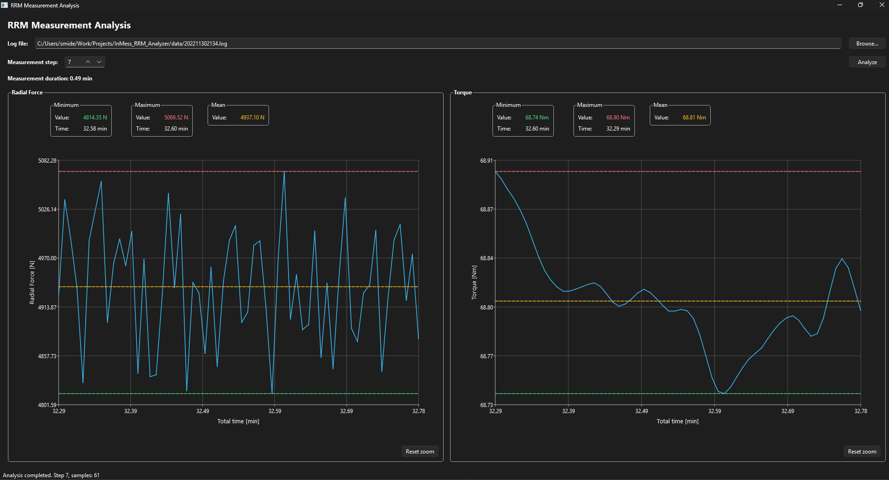

# RRM Measurement Analyzer



## 1. Project Overview

The task was to develop a C++ application with a Qt graphical interface to load an RRM log file, analyze a selected measurement step, and display the results. The main focus is the analysis of step measurements.

We divided the solution into four components:

1. **Log Parser:** Reads metadata, measurement data, and summary information from `.log` files. The caller specifies which measurement columns to load and their expected data types. The parser stores the results in a generic, column-oriented data structure.
2. **Measurement Data Mapper:** Maps the Log Parser data structure to the data structure used by the Measurement analyzer and the QT Applications (main window). Acts as a translator between the two data structure. 
3. **Measurement Analyzer:** Calculates the measurement duration and the mean, minimum, and maximum of radial force and torque. It also determines when the minimum and maximum occurred. 
4. **Qt Visualization:** Displays the calculated metrics and the measurements over time in two interactive charts. 

The log parser supports configurable column selection through a vector of `ColumnSpec` objects. Each specification defines a column name and its expected type (`Int64`, `Double`, or `String`).

For example, the Qt application requests:

```cpp
const std::vector<rrm::ColumnSpec> column_specs = {
    {"time", rrm::ValueType::Int64},
    {"radial load", rrm::ValueType::Double},
    {"torque", rrm::ValueType::Double}
};
```

The parser automatically includes the `"step"` column if it was not explicitly requested. The results are stored in `ColumnLogData`, where each column contains its own vector of typed values. The independent mapper converts these results into the original `LogData` structure used by the measurement analyzer.

Error handling is described in the "Validation and error handling" section.


## 2. Using the Application

### Select and analyze a measurement

1. Click **Browse...** to select a `.log` file.
2. Choose the measurement step using the step selector.
3. Click **Analyze** to load the data and display the results.

The step selector uses these configuration constants:

| Parameter | Value | Description |
| --- | --- | --- |
| `MIN_STEP` | `1` | Lowest selectable step; step `0` is excluded. |
| `MAX_STEP` | `9999` | Highest selectable step. |
| `DEFAULT_STEP` | `5` | Step selected when the application starts. |

The selected step must also exist in the log file. Otherwise, an error message is displayed in the GUI.
To analyze another step, simply select a different step. To choose another log file, use the file browser again. The metrics and charts will be reset automatically. Clicking **Analyze** again will recalculate the statistics and display the updated measurements.

### Results and charts

The application displays the measurement duration and the mean, minimum, and maximum values for **radial force** and **torque**, including the times of the extrema.

Each chart shows the measured values over time. Dashed horizontal lines indicate the **mean**, **minimum**, and **maximum**. The chart colors adapt to the current light or dark theme.

The original timestamps from the log file are preserved. They are **not shifted to start at zero** for the selected step, because this was not specified in the task. Milliseconds are converted to minutes only for display.

To inspect a smaller area, drag a rectangle across a chart to **zoom in**. Click **Reset zoom** to return to the full view.

### Validation and error handling

The application checks the file and measurement data before displaying results. Errors are caught and shown in a dialog, so they do not crash the application.

**File and format validation**

- The Analyze button remains disabled until a log file is selected. The GUI also checks for an empty file path. The parser checks whether the file can be opened and whether the configured delimiter and measurement-header indicator are non-empty.
- The parser requires a measurement header and all columns specified by the caller. It automatically adds the `"step"` column if it was not requested. Column names and the header indicator are matched case-sensitively.
- Each measurement row must contain exactly the same number of fields as the measurement header. Missing fields are not permitted. Empty fields are allowed if they belong to columns that are not converted or validated.
- Requested measurement values are converted according to their declared type. Integer values must be valid signed 64-bit integers, while floating-point values must be finite. Numerical conversions must consume the complete field. String values are preserved as text.
- The parser validates the field count and step number of every measurement row. However, it converts and validates the remaining requested values only for rows belonging to the selected step, or for all rows if no step filter is specified.
- File-reading errors, unexpected end-of-file conditions, and a missing `log stopped:` completion marker are detected. The parser requires the marker to occur in the summary but does not require it to be the final line.


**Step validation**

- The GUI limits the selected step to the configured range (`MIN_STEP = 1` to `MAX_STEP = 9999`). Step `0` cannot be selected.
- If the selected step is not found in a completely parsed log, the parser reports: `Step 13 not part of file. Please choose another step.` The number reflects the selected step.
- The analyzer rejects a requested step that differs from the step loaded by the parser.
- The parser can also load measurements from all steps by using `std::nullopt` as the step parameter. However, the Qt interface currently allows selecting only one step at a time.


**Measurement validation**

- Measurement timestamps must be non-negative and non-decreasing within the selected step. Consecutive measurements may have equal timestamps.
- Radial force and torque must contain finite values. Negative measurements are permitted.
- At least two measurement samples and a total measurement duration greater than zero are required for analysis.


**Error handling**

The parser distinguishes between three parsing results:

- **Complete:** The measurement table and summary were processed successfully, and the required completion marker was found.
- **Incomplete:** The file ended unexpectedly before parsing could be completed.
- **Error:** A file-opening, configuration, format, or data-conversion error occurred.

The parser stores the parsing status and an explanatory message in `ColumnLogData`. Previously loaded measurements are preserved when possible, even if parsing fails.

The measurement data mapper validates the columns required by the analyzer and reports missing columns, incorrect types, or inconsistent row counts through exceptions.

The measurement analyzer accepts only data with `ParseStatus::Complete`. Loading, mapping, and analysis errors are handled by the Qt GUI and displayed in an error dialog. After an error, the user can select another file or measurement step and try again.


## 3. Requirements and Build Instructions

The application was developed on **Windows 11** using the **MSYS2 UCRT64** toolchain.

**Requirements**

- C++17-compatible compiler (GCC via MSYS2 UCRT64 was used).
- Qt 6 with **Qt Widgets** and **Qt Charts**.
- CMake and Ninja.

**Build**

Open a terminal configured to use the MSYS2 UCRT64 compiler and Qt installation. From the project root, run:

```powershell
cmake -S . -B build -G Ninja
cmake --build build
```

**Run**

After building the project, launch the application from the project root:

```powershell
.\build\rrm_analyzer.exe
```

Make sure the required Qt libraries are available in your environment.


## 4. Project Structure

The application consists of the following components:

| File | Purpose |
| --- | --- |
| `rrm_log_parser.hpp/.cpp` | Parses RRM log files using configurable measurement columns and stores the results in a generic column-oriented structure. |
| `measurement_data_mapper.hpp/.cpp` | Converts generic `ColumnLogData` into the original `LogData` structure required by the analyzer and visualization. |
| `measurement_analyzer.hpp/.cpp` | Calculates measurement statistics for the selected step. |
| `main_window.hpp/.cpp` | Handles file selection, step selection, and coordination of parsing, mapping, analysis, and GUI updates. |
| `measurement_widget.hpp/.cpp` | Displays statistics and interactive measurement charts. |
| `log_data.hpp`, `analysis_result.hpp` | Define the data structures used for parsing, mapping, and analysis results. |

The parser stores metadata, summary information, and the requested measurement columns. The GUI currently focuses on radial force and torque statistics and time-series charts.


## 5. Testing

The project contains two standalone test executables. Both run automated checks and report a failure if an expected result is not met.

The integration tests cover the interaction between the generic log parser, the independent measurement data mapper, and the existing measurement analyzer. The parser produces column-oriented `ColumnLogData`, which is converted into the original `LogData` format when legacy measurement samples are required.

### Log Parser Test (`test_log_parser`)

The log parser test uses temporary synthetic `.log` files to verify parsing and error handling. Where required, the external mapper converts the parsed data into the original measurement sample structure.

- **Complete log and step filtering:** Verifies metadata, summary, measurement rows, step filtering, and loading all steps. Checks the generic column-oriented storage, automatic inclusion of the `"step"` column, conversion into legacy measurement samples, and parser reuse and clearing.
- **Unavailable step:** Ensures the parser rejects a step that does not exist in a completely parsed log and clears its stored data.
- **Incomplete log:** Verifies that an unexpected end of file produces an `Incomplete` status and previously parsed measurements remain available after conversion.
- **Invalid measurement row:** Checks that an incorrect number of fields produces an `Error` while preserving earlier valid measurements.
- **Missing completion marker:** Verifies that a missing `log stopped:` marker produces an `Incomplete` result without discarding previously parsed samples.
- **Custom delimiter:** Confirms that a log using `|` instead of `;` can be parsed correctly.
- **File and configuration errors:** Checks that a missing file and an empty delimiter produce appropriate errors. Also verifies that the mapper preserves error information when no measurement columns were initialized.
- **Real-log integration:** Loads step 5 from an actual RRM log file, converts the result using the mapper, and verifies successful parsing, step filtering, and consistent sample counts.

### Measurement Analyzer Test (`test_measurement_analyzer`)

The measurement analyzer test uses predefined `LogData` objects to verify the existing statistical calculations and validation rules independently of the parser.

- **Known measurement statistics:** Uses predefined samples with known results to verify step filtering, sample count, start time, duration, mean, minimum, maximum, and timestamps of extrema. Floating-point results are compared against expected values using a defined tolerance.
- **Parse status validation:** Confirms that incomplete or invalid log data cannot be analyzed.
- **Step selection validation:** Ensures the analyzer rejects a requested step that differs from the step loaded by the parser.
- **Insufficient samples:** Verifies that zero or one sample is rejected.
- **Invalid measurement values:** Checks that negative timestamps, `NaN`, and infinite measurement values are rejected.
- **Timestamp validation:** Rejects decreasing timestamps or a total measurement duration of zero.
- **Parser, mapper, and analyzer integration:** Loads step 5 from an actual RRM log file, converts the column-oriented data into `LogData`, and performs the statistical analysis. Verifies sample count, start time, duration, finite statistics, consistent extrema, and valid extrema timestamps. The calculated statistics are printed but are not compared against predefined reference values.

### Running the tests

The parser tests create temporary synthetic `.log` files and remove them afterward. Both executables also perform an integration test using `data/202211302134.log` by default.

Run the following commands from the project root so the relative path resolves correctly:

```powershell
.\build\test_log_parser.exe
.\build\test_measurement_analyzer.exe
```

To test another log file, provide its path as the first command-line argument, for example:

```powershell
.\build\test_measurement_analyzer.exe .\data\another_measurement.log
```

The specified log file must contain the measurement columns required by the tests.

## 6. Future Work
The current application analyzes RRM log files offline. In a production machine, the **PLC would remain responsible for machine control**, while a separate PC would handle data processing, analysis, and visualization. 

Possible extensions include:

- **PLC communication:** Receive measurement data and machine status from the PLC through a suitable communication interface. Machine control and safety functions remain with the PLC.
- **Database integration:** Store measurement data, metadata, and analysis results in a database. Support efficient searches and loading of historical measurements without reading all records at once.
- **Customer system integration:** Exchange relevant measurement results or status information with the customer's higher-level supervisory system or other IT systems, if required.
- **Extended GUI:** Add pages for live measurements, historical results, diagnostics, data export, and visualization settings.
- **Background processing:** Run data reception, database queries, and time-consuming analysis in worker threads so the Qt interface remains responsive.
- **Visualization performance:** Improve the display of large datasets, for example by plotting a reduced number of points while keeping the full data for analysis.
- **Reliability and security:** Add connection monitoring, error logging, reconnection handling, and appropriate access protection for external interfaces.
- **Cross-platform support:** Extend the software to run reliably on both Linux and Windows. Avoid operating-system-specific dependencies where possible, adapt the build and deployment process, and test the application on both platforms.
- **Integration testing and deployment:** Test data exchange with the PLC and any connected customer systems, including communication failures. Verify the application on the target visualization PC, such as an Ubuntu system or windows.
