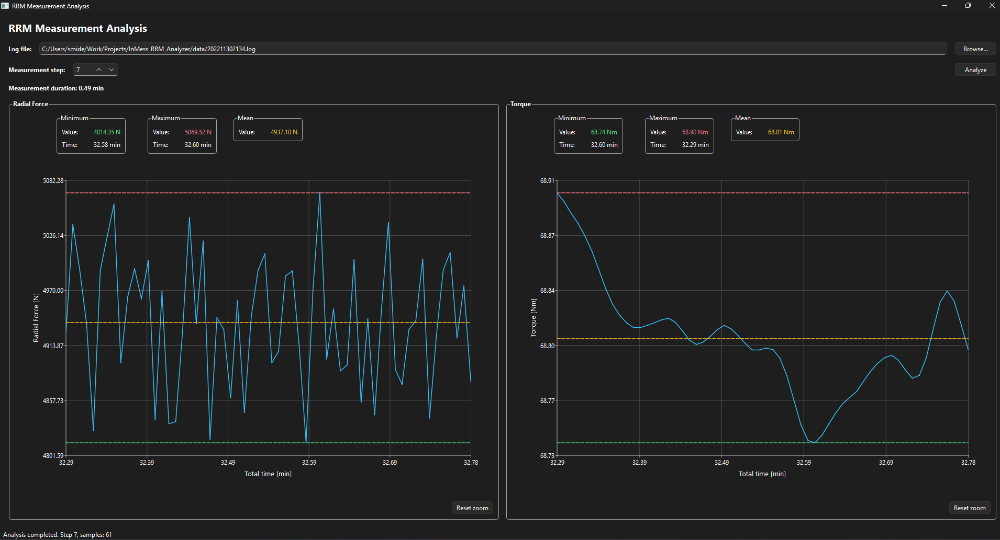

# RRM Measurement Analyzer



## 1. Project Overview

The task was to develop a C++ application with a Qt graphical interface to load an RRM log file, analyze a selected measurement step, and display the results. The main focus is the analysis of step measurements.

We divided the solution into three components:

1. **Log Parser:** Reads the metadata, measurement table, and summary from a `.log` file. It loads the selected step and validates the file content. 
2. **Measurement Analyzer:** Calculates the measurement duration and the mean, minimum, and maximum of radial force and torque. It also determines when the minimum and maximum occurred. 
3. **Qt Visualization:** Displays the calculated metrics and the measurements over time in two interactive charts. 

Error handling is described in the "Validation and error handling" section.


## 2. Using the Application

### Select and analyze a measurement

1. Click **Browse...** to select a `.log` file.
2. Choose the measurement step using the step selector.
3. Click **Analyze** to load the data and display the results.

The step selector uses these configuration constants:

| Parameter | Value | Description |
| --- | --- | --- |
| `MIN_STEP` | `1` | Lowest selectable step; step `0` is excluded. |
| `MAX_STEP` | `9999` | Highest selectable step. |
| `DEFAULT_STEP` | `5` | Step selected when the application starts. |

The selected step must also exist in the log file. Otherwise, an error message is displayed in the GUI.
To analyze another step, simply select a different step. To choose another log file, use the file browser again. The metrics and charts will be reset automatically. Pressing **Analyze** button gain will compute the new ones and display the data.

### Results and charts

The application displays the measurement duration and the mean, minimum, and maximum values for **radial force** and **torque**, including the times of the extrema.

Each chart shows the measured values over time. Dashed horizontal lines indicate the **mean**, **minimum**, and **maximum**. The chart colors adapt to the current light or dark theme.

The original timestamps from the log file are preserved. They are **not shifted to start at zero** for the selected step, because this was not specified in the task. Milliseconds are converted to minutes only for display.

To inspect a smaller area, drag a rectangle across a chart to **zoom in**. Click **Reset zoom** to return to the full view.

### Validation and error handling

The application checks the file and measurement data before displaying results. Errors are caught and shown in a dialog, so they do not crash the application.

**File and format validation**

- The Analyze button remains disabled until a log file is selected. The GUI also checks for an empty file path. The parser checks whether the file can be opened and whether the configured delimiter is not empty.
- The parser requires a measurement header and the necessary columns for time, step, radial force, and torque. It also checks whether the number of fields in each measurement row matches the expected number of columns from the header, allowing one missing trailing empty field ("message"). An error is reported if the validation fails.
- File reading errors, unexpected end-of-file conditions, and a missing final `log stopped:` marker are detected. Incomplete or invalid logs are rejected by the analyzer.

**Step validation**

- The GUI limits the selected step to the configured range (`MIN_STEP = 1` to `MAX_STEP = 9999`). Step `0` cannot be selected.
- If the selected step is not found in a completely parsed log, the parser reports: `Step 13 not part of file. Please choose another step.` The number reflects the selected step.
- The analyzer rejects a requested step that differs from the step loaded by the parser.

**Measurement validation**

- Measurement timestamps must be non-negative and must not decrease within the selected step. Radial force and torque values must be finite numbers.
- At least two samples and a measurement duration greater than zero are required for analysis.

**Error handling**

- Loading and analysis errors are caught by the GUI and displayed in an error dialog. Once the user has confirmed the error, interaction with the GUI resumes.


## 3. Requirements and Build Instructions

The application was developed on **Windows 11** using the **MSYS2 UCRT64** toolchain.

**Requirements**

- C++17-compatible compiler (GCC via MSYS2 UCRT64 was used).
- Qt 6 with **Qt Widgets** and **Qt Charts**.
- CMake and Ninja.

**Build**

Open a terminal configured to use the MSYS2 UCRT64 compiler and Qt installation. From the project root, run:

```powershell
cmake -S . -B build -G Ninja
cmake --build build
```

**Run**

After building the project, launch the application from the project root:

```powershell
.\build\rrm_analyzer.exe
```

Make sure the required Qt libraries are available in your environment.


## 4. Project Structure

The application is divided into separate components:

| File | Purpose |
| --- | --- |
| `rrm_log_parser.hpp/.cpp` | Reads and validates RRM log files and selects measurement samples. |
| `measurement_analyzer.hpp/.cpp` | Calculates measurement statistics for the selected step. |
| `main_window.hpp/.cpp` | Handles file selection, step selection, analysis, and errors in the GUI. |
| `measurement_widget.hpp/.cpp` | Displays statistics and interactive measurement charts. |
| `log_data.hpp`, `analysis_result.hpp` | Define the data structures exchanged between components. |

The parser also reads **metadata and summary information** from the log. The current GUI focuses on measurement statistics and time-series charts and does not display those other sections.


**Both tests use data/202211302134.log by default. The file must be available at the expected path**. A different log file can be provided as a command-line argument.


## 5. Testing

The project contains two standalone test executables. Both run automated checks and report a failure if an expected result is not met.

1. **Log Parser Test (`test_log_parser`)**
    - **Complete log and step filtering:** Uses a valid test log to verify metadata, summary, measurement rows, selected step 5, and loading all steps. Also checks that the parser can be reused and cleared.
    - **Unavailable step:** Ensures the parser rejects a step that does not exist in a completely parsed log and clears its stored data.
    - **Incomplete log:** Verifies that an unexpected end of file is reported as `Incomplete` and previously parsed measurements remain available.
    - **Invalid measurement row:** Checks that an incorrect column count produces an `Error` while preserving earlier valid measurements.
    - **Missing completion marker:** Verifies that a missing final `log stopped:` marker produces an `Incomplete` result without discarding parsed samples.
    - **Custom delimiter:** Confirms that a log using `|` instead of `;` can be parsed correctly.
    - **File and configuration errors:** Checks that a missing file and an empty delimiter are reported as errors.
    - **Real-log integration:** Loads step 5 from an actual RRM log file and verifies successful parsing, step filtering, and consistent sample counts.

2. **Measurement Analyzer Test (`test_measurement_analyzer`)**
    - **Known measurement statistics:** Uses predefined samples with known results to verify step filtering, sample count, start time, duration, means, minima, maxima, and extrema timestamps. Floating-point results are compared with a defined tolerance.
    - **Parse status validation:** Confirms that incomplete or invalid parser results cannot be analyzed.
    - **Step selection validation:** Ensures the analyzer rejects a step different from the one loaded by the parser.
    - **Insufficient samples:** Verifies that zero or one sample is rejected.
    - **Invalid measurement values:** Checks that negative timestamps, `NaN`, and infinite measurement values are rejected.
    - **Timestamp validation:** Rejects measurements with decreasing timestamps or a total duration of zero.
    - **Parser and analyzer integration:** Loads step 5 from an actual RRM log file and checks parsing status, sample count, start time, duration, finite statistics, and plausible extrema values and timestamps. Computed statistics are printed but are not compared with predefined reference values.

The parser tests create temporary synthetic `.log` files for their individual test cases and remove them afterward. **Both executables also run an integration test using `data/202211302134.log` by default.** Run the commands from the project root so that the relative path resolves correctly. You can supply a different log file as the first command-line argument.

Run both tests with:

```powershell
.\build\test_log_parser.exe
.\build\test_measurement_analyzer.exe
```

To use another log file, append its path to either command, for example:

```powershell
.\build\test_measurement_analyzer.exe .\data\another_measurement.log
```

## 6. Future Work
The current application analyzes RRM log files offline. In a production machine, the **PLC would remain responsible for machine control**, while a separate PC would handle data processing, analysis, and visualization. 

Possible extensions include:

- **PLC communication:** Receive measurement data and machine status from the PLC through a suitable communication interface. Machine control and safety functions remain with the PLC.
- **Database integration:** Store measurement data, metadata, and analysis results in a database. Support efficient searches and loading of historical measurements without reading all records at once.
- **Customer system integration:** Exchange relevant measurement results or status information with the customer's higher-level supervisory system or other IT systems, if required.
- **Extended GUI:** Add pages for live measurements, historical results, diagnostics, data export, and visualization settings.
- **Background processing:** Run data reception, database queries, and time-consuming analysis in worker threads so the Qt interface remains responsive.
- **Visualization performance:** Improve the display of large datasets, for example by plotting a reduced number of points while keeping the full data for analysis.
- **Reliability and security:** Add connection monitoring, error logging, reconnection handling, and appropriate access protection for external interfaces.
- **Cross-platform support:** Extend the software to run reliably on both Linux and Windows. Avoid operating-system-specific dependencies where possible, adapt the build and deployment process, and test the application on both platforms.
- **Integration testing and deployment:** Test data exchange with the PLC and any connected customer systems, including communication failures. Verify the application on the target visualization PC, such as an Ubuntu system or windows.
